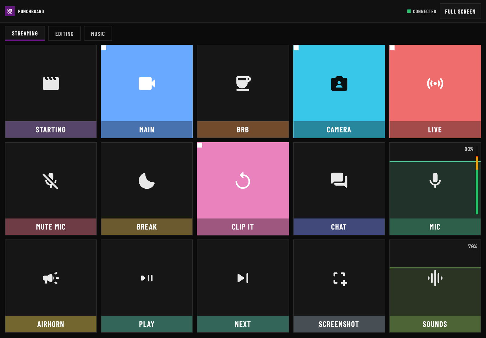
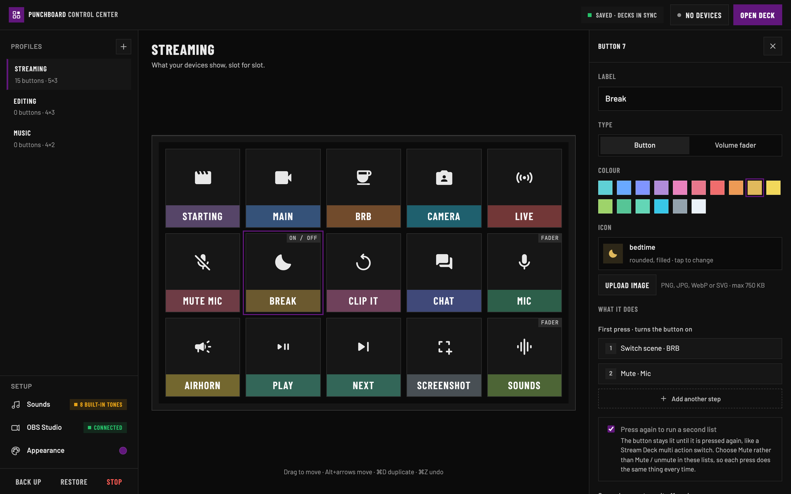
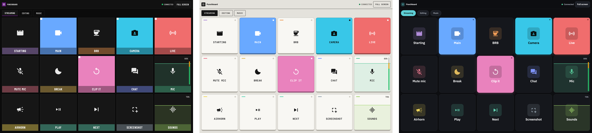

# Punchboard

[](https://ko-fi.com/hit_here)

Turn any tablet or phone into a macro pad for your computer: buttons and faders for shortcuts, apps, music, sounds and volume, with deep OBS support for streaming. Punchboard runs on your computer; your devices connect to it over the same wifi, in the browser. No account, no cloud, nothing to install on the tablet.

<p align="center"></p>

## Install

Download the latest version from **[Releases](https://github.com/GH-Jaider/punchboard/releases/latest)**:

- **Mac**: `Punchboard_…_apple-silicon.dmg` (M1 and newer) or `Punchboard_…_intel.dmg`. Open it and drag Punchboard to Applications.
- **Windows**: `Punchboard_…_windows-x64-setup.exe`.
- **Linux** (experimental): there is no installer yet; build it from source. [Linux](#linux) says what is there and what is not.

Punchboard is not signed by Apple or Microsoft, so the first time you open it:

- **Mac**: macOS says it cannot check the app. Open **System Settings › Privacy & Security**, scroll down and click **Open Anyway**.
- **Windows**: click **More info › Run anyway**. If Windows Firewall asks, allow Punchboard on **private networks** so your devices can reach it.

After that it updates itself.

## First steps

1. **Pair a device.** In Punchboard, click **Pair a device** and scan the QR code with the tablet or phone. Keep both on the same wifi.
2. **Build your deck.** Click an empty slot to add a button, pick what it does, and it appears on your devices right away.
3. **Streaming? Connect OBS.** In OBS, open **Tools › WebSocket Server Settings** and tick **Enable WebSocket server**. Punchboard finds it by itself. Everything else works without OBS.

The first time the Control Center opens, a short tour points these out; the **?** next to the version plays it again.

On an iPad, tap **Full screen** on the deck. On an iPhone, use **Share › Add to Home Screen** for a full-screen deck.

## What buttons can do

<p align="center"></p>

- **This computer**: press key combinations (any app's shortcuts), launch apps, open links, control music (play / pause, next, previous) and play sounds.
- **OBS**: switch scenes, show or hide sources, mute inputs, turn filters on or off, start or stop the stream, recording and virtual camera, save a replay, and send the preview live in Studio Mode. Buttons light up with what OBS is doing, even when you change it in OBS itself.
- **The deck**: go to another deck, or open a link on the device.
- **Faders**: the computer's volume, one app's volume, Punchboard's sounds, or an OBS input. On Windows and Linux any app that plays sound (Chrome, Spotify, Discord, a game); on a Mac, which has no per-app volume, Music and Spotify.
- **Trackpad decks**: set a deck's type to *Trackpad* and the whole screen works like a laptop trackpad: tap, drag, two-finger scroll with momentum, pinch to zoom, and three- and four-finger swipes for Mission Control, desktops and the desktop.
- **Macros**: several steps in a row, each with its own delay. A macro can also run a second list when pressed again, like a *Break* button that goes to BRB and mutes the mic, then comes back.

Three looks, for the Control Center and every device at once: **Broadcast**, **Hardware** and **Studio**, each with your own accent colour.

<p align="center"></p>

On a Mac, key combinations, music controls and the trackpad need a one-time permission: **System Settings › Privacy & Security › Accessibility**, allow Punchboard. If you are updating from a version that already had it, macOS asks for it once more: Punchboard now sends the keys itself, where it used to ask System Events to.

## Good to know

- Only paired devices can press buttons, and only this computer can edit decks. Remove a device in **Pair a device** to cut it off.
- Your decks, sounds and paired devices live in their own folder, so updates never touch them: `~/Library/Application Support/Punchboard` on Mac, `%APPDATA%\Punchboard` on Windows, `~/.config/punchboard` on Linux. **Back up** in the Control Center saves your decks (buttons, macros and layouts) to a file, and **Restore** brings them back; custom sounds, the theme and paired devices are not in it, so copy that folder to keep everything. Punchboard also keeps a daily copy of your decks in `decks/backups` inside it.
- **Lock the device to the deck**, so a swipe from the edge cannot leave it mid-stream: **Guided Access** on iPad and iPhone (Settings › Accessibility, then triple-click), **App pinning** on Android (Settings › Security). Full screen helps too.
- **Keep the device's screen on yourself**: a page on your local wifi cannot do it. On iPad and iPhone set **Settings › Display & Brightness › Auto-Lock** to Never; on Android set **Settings › Display › Screen timeout** (or *Sleep*) to the longest.

## Linux

Linux is experimental. Plainly:

- **Built from source, no installer.** There is no package to install and nothing updates by itself: `npm install` and `npm start` build Punchboard and run it, and the Control Center opens in your browser ([For developers](#for-developers) has what it needs).
- **Keys and the pointer** go through X11 (the XTEST extension) on an X11 session, and through a virtual keyboard and mouse on `/dev/uinput` on Wayland. On Wayland your account must be allowed to open `/dev/uinput`, which it often is not by default; until it is, a key or trackpad press answers that Linux needs permission first.
- **Trackpad gestures are keyboard shortcuts**, the ones GNOME and KDE share or come closest on, so what each does depends on your desktop and its shortcut settings:

  | Gesture | Shortcut sent | Meant for |
  |---|---|---|
  | Three or four fingers up | Super | the overview |
  | Three or four fingers down | Super+D | show the desktop |
  | Three fingers left · right | Alt+Tab · Alt+Shift+Tab | next · previous app |
  | Four fingers left · right | Ctrl+Alt+Right · Ctrl+Alt+Left | next · previous workspace |
  | Three-finger tap | Super | the overview, where typing searches |
  | Four fingers spread | Super+D | show the desktop |
  | Four fingers pinch | Super+A | the app grid |
  | Two-finger pinch | Ctrl + the scroll wheel | zoom |

- **Sound**: buttons play their sounds on the default output (ALSA, which PulseAudio and PipeWire take over on a desktop). The volume faders, the computer's and each app's, talk to PulseAudio or to PipeWire through `pipewire-pulse`; without one of them they have nothing to set.
- **Not yet tried on a real desktop.** It is built and tested on Linux with no display, no sound server and no input devices, where everything that would touch them is written to files instead. Nobody has pressed a deck's button on a real GNOME or KDE session yet, so expect rough edges and please report them.

## Languages

Punchboard speaks English and Spanish. **Appearance › Language** in the Control Center picks one for the Control Center and every device, or *Automatic*, where each device follows its own language (and English when Punchboard does not speak it).

To add a language, copy `public/locales/en.json` to `public/locales/<code>.json` (`fr.json`, `pt-BR.json`), set `meta.name` to the language's own name (`Français`) and `meta.code` to the code, translate the values, keeping every `{placeholder}` as it is, run `npm run fixtures`, and open a pull request. Nothing else needs to change: the new file shows up in the picker by itself, and the companion, the pages and the menu-bar menu all read it. `npm test` checks that every locale file has exactly English's keys, placeholders and plural forms (`one` / `other`, or whichever of CLDR's categories the language needs), so a missing or extra line is caught before it ships.

## For developers

Punchboard is a companion in Rust and pages in strict TypeScript: `server/` (the companion, a crate of its own; `server/README.md` says how it is laid out and tested), `src/client` (Control Center and deck, bundled by esbuild) and `src/shared` (the model and API types the pages use, which the companion keeps a twin of in `server/src/model`). The desktop app is a small Tauri shell in `src-tauri` that carries the companion as a program of its own.

```sh
npm install
npm run check     # type-check, lint and build the pages
npm start         # build and run the companion from source (or start.command / start.bat)
npm test          # build the companion and test it from outside, against a fake OBS
npm run test:rust # the companion's own tests (cargo test in server/)
npm run app:dev   # the desktop app
```

Running from source needs Rust ([rustup.rs](https://rustup.rs)) and Node 22.18 or newer. On Linux, which is experimental and has no installer yet ([Linux](#linux)), it also needs the system libraries listed in `server/README.md`; after that, `npm install` and `npm start` build and run Punchboard there too.

The companion's twin of the shared code is held to it by fixtures in `tests/fixtures`: after changing `src/shared` or a locale file, run `npm run fixtures` and commit what it changed (CI checks that nothing is left to regenerate).

The deck runs on old tablets too (Safari 11, ES2015): keep newer JavaScript and CSS out of `src/client/deck` and the shared code.

Interface text lives in `public/locales/en.json`, never in the code: pages call `t("deck.status.connected")` (`src/shared/i18n.ts`), the HTML marks its English with `data-i18n="…"` attributes, and the companion returns `UserError::new(say("server.…"))` or `HttpError::new(status, say("server.…"))`, worded in the asker's language when sent. `tests/i18n-literals.mjs` lists English left in the code, TypeScript and Rust; its `ALLOWED` list says what rightly stays English (log lines, the system's own reasons).

Pushing a tag like `v1.2.0` builds the Mac and Windows apps on GitHub Actions and drafts a release with them.

## Support

Punchboard is free. If it earns a place in your setup, you can buy its maker a coffee on **[Ko-fi](https://ko-fi.com/hit_here)**.

## License

[Apache License 2.0](LICENSE). Fonts under the SIL Open Font License; Google's Material Symbols under Apache 2.0. The Control Center's tour uses [driver.js](https://driverjs.com) by Kamran Ahmed, under the MIT License, whose text heads the bundled `public/js/tour.js`.
